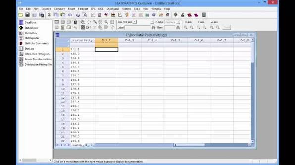
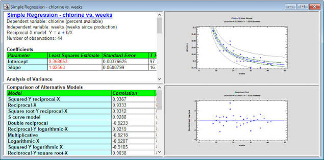

# Statgraphics Centurion Connects Statistical Evidence With Decisions

Statgraphics Software combines statistical analysis, visualization, and reporting in a Windows desktop environment.
A useful analysis starts with identifiable observations and ends with a conclusion whose assumptions and uncertainty remain visible.

[](https://statgraphics-software.github.io/Statgraphics-Centurion/)

## Describe the observations before selecting a procedure

Identify what one row represents: a specimen, a production run, a customer, or a repeated measurement.
Record measurement units, group definitions, missing-value codes, and any exclusions.
A numeric identifier should not become a continuous predictor simply because the spreadsheet stores it as a number.

The [Centurion overview](https://www.statgraphics.com/centurion-overview) describes the product's statistical and graphical analysis environment.
Use preliminary summaries to find data-definition problems before interpreting a fitted model or hypothesis test.

For an independent data review in R, prepare measurements.csv with numeric response and temperature columns and a group column:

```r
d <- read.csv("measurements.csv", na.strings = c("", "NA"))
str(d)
colSums(is.na(d))
stopifnot(is.numeric(d$response))
summary(d$response)
```

R's [data-input reference](https://stat.ethz.ch/R-manual/R-devel/library/utils/html/read.table.html) explains CSV import and missing-value conventions.
Check the imported column types against the source rather than treating a successful import as validation.

The documentation generator [dataset_rst.py](tools/dataset_rst.py) extracts dataset metadata into reference pages.
The conversion utility [estmat2nparray.ado](tools/estmat2nparray.ado) preserves estimation results and matrix labels from Stata for Python.
Both illustrate why values need names and context when moving between analytical tools.

## Keep group comparisons tied to the sampling design

Two columns of measurements do not by themselves identify the correct comparison.
Determine whether observations are independent, paired, repeated over time, or nested within batches.
State the population and the quantity being estimated before examining a p-value.

| Structure of the observations | Information the analysis must preserve |
| --- | --- |
| Two independent groups | Group membership and within-group variation |
| The same units measured twice | Pair identifiers and the direction of each difference |
| Repeated production measurements | Time order and any rational subgroup definition |
| Multiple predictors with a response | Predictor coding, included terms, and the analysis sample |

For two independent groups labelled A and B, the following R continuation uses Welch's two-sample t-test:

```r
comparison <- subset(d, group %in% c("A", "B"))
comparison <- comparison[complete.cases(comparison[c("response", "group")]), ]
comparison$group <- droplevels(factor(comparison$group))
t.test(response ~ group, data = comparison, var.equal = FALSE)
```

The [t.test reference](https://stat.ethz.ch/R-manual/R-devel/library/stats/html/t.test.html) documents the unequal-variance option.
Use this example only when both groups contain enough usable observations and the independent-sample assumptions fit the study.
Review the estimated difference and confidence interval alongside the test result.



The [Statgraphics Statistics Library](https://www.statgraphics.com/Statistics-library) provides procedure-specific explanations, formulas, and worked examples.
Use the documentation for the selected procedure to interpret its output and assumptions.

## Separate a fitted relationship from an adequate model

Regression can describe an association without establishing a causal explanation.
Inspect residual patterns, influential observations, and the range of predictor values represented in the data.
For production studies, distinguish variation over time from variation explained by the chosen predictors.

This Python example fits a linear model with temperature and categorical group using pandas and statsmodels:

```python
import pandas as pd
import statsmodels.formula.api as smf

data = pd.read_csv("measurements.csv")
analysis = data.dropna(subset=["response", "temperature", "group"])
fit = smf.ols("response ~ temperature + C(group)", data=analysis).fit()
print("Rows retained:", int(fit.nobs))
print(fit.summary())
```

The [statsmodels formula guide](https://www.statsmodels.org/stable/example_formulas.html) explains formula-based fitting and categorical terms.
Confirm that the retained sample contains sufficient variation to estimate the specified terms.
Compare fitted values and residuals with the observations before using the model for prediction.

The helper [generate_formula_api.py](tools/generate_formula_api.py) generates formula-API entries for the companion library.
The script [check_api.py](tools/check_api.py) compares API entry points with exported names.
The validator [validate_docstrings.py](tools/validate_docstrings.py) checks documentation structure.
These tools address interface consistency; model adequacy still depends on the data and analytical assumptions.



## Reuse routines through the supported language interfaces

Statgraphics Centurion 19 includes an interface for sharing data and results with Python.
The [Python-interface description](https://www.statgraphics.com/statgraphics-python-interface) explains how commands can be retained in a StatFolio.
The [R-interface description](https://www.statgraphics.com/statgraphics-r-interface) describes sharing data, collecting output, and saving command sequences.

Keep transferred column names, category coding, and missing-value handling explicit.
When comparing output across programs, align the model terms, included rows, and estimation options.
Numerically similar coefficients alone do not establish that two analyses used the same specification.

The supplied R-to-Python references document an older approach to exchanging numerical results:

- [README.txt](tools/R2nparray/README.txt) explains the R2nparray helper functions and their intended use.
- [R2nparray.R](tools/R2nparray/R/R2nparray.R) converts named R objects into Python expressions.
- [R2nparray-package.R](tools/R2nparray/R/R2nparray-package.R) supplies package-level documentation metadata.
- [DESCRIPTION](tools/R2nparray/DESCRIPTION) identifies the package and its numerical conversion purpose.
- [NAMESPACE](tools/R2nparray/NAMESPACE) defines its export pattern.
- [ex_sur.R](tools/R2nparray/R/ex_sur.R) demonstrates a seemingly unrelated regression workflow using R packages.

Review the helper's limited type inference before using it as a reference for an exchange routine.
Select the language-interface workflow documented for the installed Centurion version.

## Keep the analysis trail with the interpretation

Save the selected procedures, data references, transformations, and decision notes in the StatFolio.
Use StatAdvisor explanations as a starting point for communicating results, then add the study context.
State what was estimated, which observations were used, and what uncertainty remains.

When revisiting reports labelled Statgraphics Centurion 18 or Statgraphics Centurion 16, identify the original procedure and options.
Record the application version used for the new analysis rather than assuming older output describes the current configuration.

For companion notebook documentation, [export_notebooks_to_python.py](tools/export_notebooks_to_python.py) creates Python exports.
The generator [nbgenerate.py](tools/nbgenerate.py) executes and renders example notebooks.
Preserve the source notebook when reviewing an exported or rendered version.

Verification records can document how the routines behind an analysis are exercised.
The checker [check_public_api_coverage.py](tools/check_public_api_coverage.py) detects unexercised public objects using coverage results.
The report tool [class_coverage_report.py](tools/class_coverage_report.py) ranks estimation classes by untested code.
The configuration [coverage_public_api.cfg](tools/coverage_public_api.cfg) defines coverage exclusions.
The baseline [public_api_coverage_baseline.json](tools/public_api_coverage_baseline.json) records existing coverage gaps.

Coverage describes executed code, not proof that a statistical conclusion is correct.
Use numerical reference results and procedure documentation when checking analytical output.
The record [CITATION.cff](CITATION.cff) identifies statsmodels and its preferred citation.
The index [CHANGES.md](CHANGES.md) points to the library's release history.

## Related Search Terms

Statgraphics Software, Statgraphics Centurion, statgraphics centurion 19, statgraphics centurion 18, statgraphics centurion 16, statistics, data-analysis, data-visualization, hypothesis-testing, regression-models, quality-control, design-of-experiments, predictive-analytics, r, python
